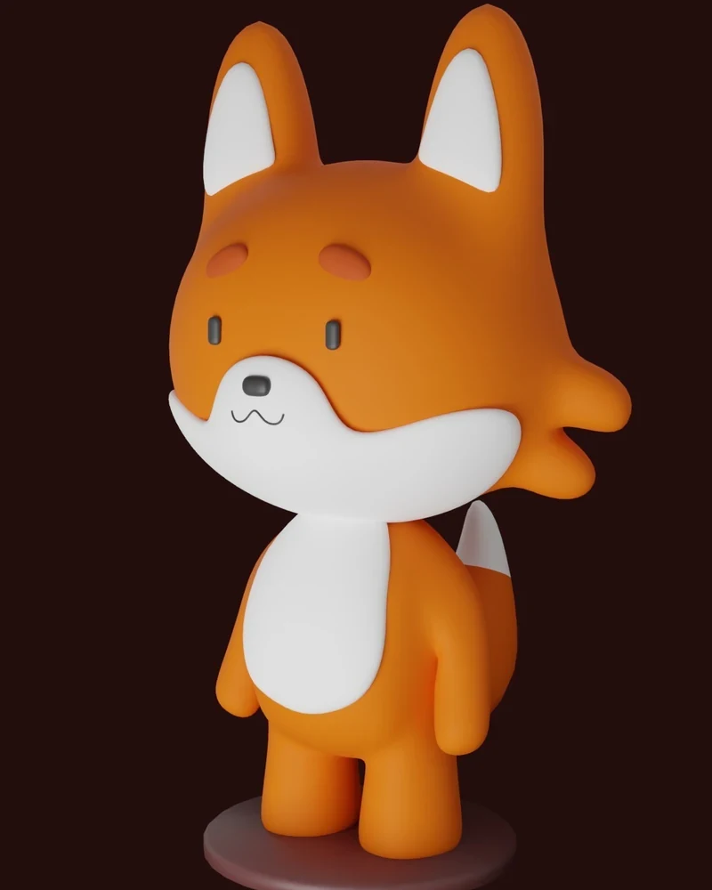
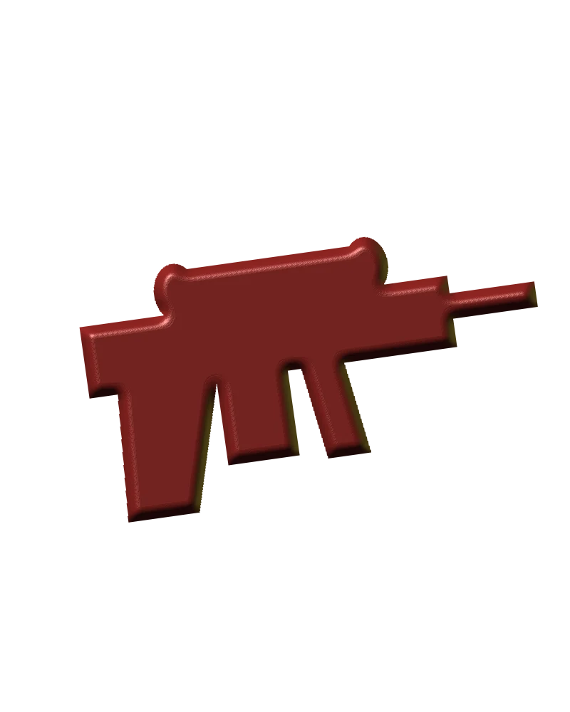
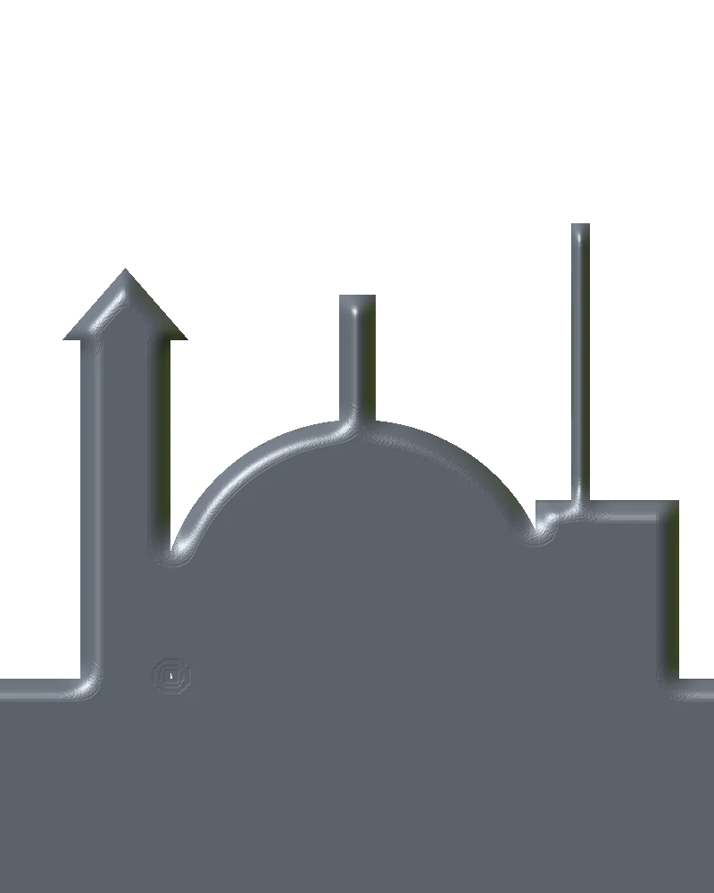

# Zakharii Stroich — Character & Technical Artist

Portfolio of Zakharii Stroich, a character and technical artist from Lublin, Poland, and a 3rd-year Informatics student at KUL. The site presents game-ready characters, hard-surface props and an environment, with topology, UVs and PBR texturing — from sculpt to Unreal Engine 5. Modelling is done in Blender, ZBrush and Substance Painter.

**Live site:** [dragodar02.github.io/MySuperSite](https://dragodar02.github.io/MySuperSite/)

## Preview

| [Cyber Samurai](character.html) | [Hard Surface Props](props.html) | [Sci-Fi Outpost](environment.html) |
| --- | --- | --- |
|  |  |  |

## Pages

| Page | What it shows |
| --- | --- |
| `index.html` | Home: hero, selected work, technical breakdown, pipeline, about, contact |
| `character.html` | Case study — Cyber Samurai |
| `props.html` | Case study — Hard Surface Props |
| `environment.html` | Case study — Sci-Fi Outpost |
| `404.html` | Missing-page screen, same layout as the rest of the site |

The home page filters work by character, hard surface and environment. Each case study has a before/after comparison, shading modes, and the stats defined for that project. Cyber Samurai and Hard Surface Props also show a UV layout and a PBR map breakdown. The contact form opens the visitor's email app; it does not post to a server.

## Tech stack

Static HTML, CSS and JavaScript. There is no framework and no required build for hosting.

Optional libraries, loaded from a CDN and skipped cleanly if they fail: [GSAP](https://gsap.com/) and ScrollTrigger, [Lenis](https://github.com/darkroomengineering/lenis) for smooth scroll, and [Three.js](https://threejs.org/) 0.160 for the hero. The hero reads `data-video`, `data-model` and `data-poster` on the home section. With both media attributes empty it draws a point field behind the poster, and it falls back to the still image when WebGL is unavailable, Save-Data is on, or the visitor prefers reduced motion.

Tools listed on the pipeline: ZBrush, Blender, Maya, Substance 3D Painter, Marmoset Toolbag, RizomUV, Marvelous Designer, Unreal Engine 5.

## Run locally

From the repository root:

```bash
python3 -m http.server 8080
```

Open [http://localhost:8080/](http://localhost:8080/). Links and assets are relative, so the same files also work under the GitHub Pages subpath `/MySuperSite/`.

## Build

Page copy, projects, pipeline stages and tool list live in `tools/build.py`. Regenerate the HTML from the repo root:

```bash
python3 tools/build.py
```

That writes `index.html`, `character.html`, `props.html`, `environment.html` and `404.html`. The HTML is plain and can be edited by hand; the next run overwrites those five files. Images stay in `assets/img` and are referenced by filename (`bust-beauty.webp`, `prop-beauty.webp`, `env-beauty.webp`, the wire and topology passes, `uv-layout.webp`, and the `pbr-*` maps). The portrait is `assets/img/avatar.jpg`. The renders currently in the repo are stand-ins; replace the files and keep the names. Polycounts and UV stats are the values in `PROJECTS` inside `tools/build.py`.

## GitHub Pages

The site is meant to be served from the `main` branch, folder `/ (root)`, at [https://dragodar02.github.io/MySuperSite/](https://dragodar02.github.io/MySuperSite/). `.nojekyll` is in the root so Pages does not run Jekyll. `404.html` uses `/MySuperSite/…` paths because Pages shows that file at the missing URL; every other page uses relative paths.

## Credits

The Blender, ZBrush and Substance Painter icons in `assets/icons` (`icons8-blender-3d-48.png`, `icons8-zbrush-100.png`, `icons8-substance-painter-64.png`) are from [Icons8](https://icons8.com).
